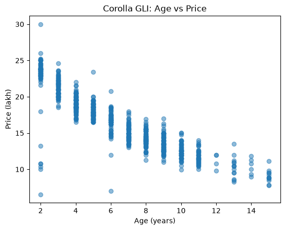
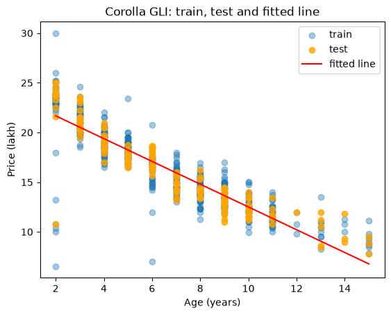
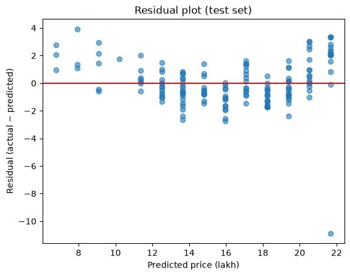

# 🚗 Used Car Price Prediction with Simple Linear Regression


**Machine Learning Lab 05 (CS-3105)** · Syeda Khadija Hassan · Roll No. 2024-SE-09
Department of Software Engineering, University of Azad Jammu & Kashmir, Muzaffarabad

How much does a Toyota Corolla GLI lose in value each year? This project answers that question with real OLX Pakistan listings. It builds a price predictor from one feature, the **age of the car**, using the least squares method, and tests how well it works on ads the model has never seen.

## At a glance

| Typical error on unseen ads | Variation explained | Value lost per year |
|:---:|:---:|:---:|
| **1.19 lakh** (MAE) | **84.5 %** (test R²) | **1.15 lakh** |

**Fitted line:** `price (lakh) = 23.97 − 1.146 × age`

## Contents

- [Dataset](#dataset)
- [Method](#method)
- [Results](#results)
- [Analysis](#analysis)
- [Limitations](#limitations)
- [Project structure](#project-structure)
- [How to run](#how-to-run)

## Dataset

Cleaned OLX Pakistan used-car ads (Open Data Pakistan, 2021), supplied with the lab: **20,484 ads** in total. For this lab I kept:

| Filter | Value |
|---|---|
| `Model` | Corolla GLI |
| `Transaction Type` | Cash |
| `Year` | 2005 to 2018 |
| `Price_lakh` | between 5 and 40 |

This leaves **796 ads**. The feature is `Age` (2020 minus the year, in years) and the target is `Price_lakh` (1 lakh = 100,000 PKR).

## Method

1. **Explore:** summary statistics, correlation and a scatter plot.
2. **Split:** 80 % training (636 ads) and 20 % test (160 ads) with `random_state=42`.
3. **Fit by hand (NumPy, training data only):**

   ```
   b1 = Σ(x − x̄)(y − ȳ) / Σ(x − x̄)²
   b0 = ȳ − b1·x̄
   ```

4. **Fit with scikit-learn:** `LinearRegression()` gives the same slope and intercept, confirmed with `np.isclose`.
5. **Evaluate on the test set:** MAE, MSE, RMSE and R², computed from the formulas and checked with `sklearn.metrics`. Compared with train R² and with a baseline that always predicts the training mean.
6. **Inspect:** fitted-line plot, residual plot and the five largest errors.
7. **Predict:** prices for 2018, 2015, 2010 and 1995 cars.

## Results

| Metric | Value |
|---|---|
| Correlation (age, price) | −0.896 |
| Slope b₁ | −1.146 lakh per year |
| Intercept b₀ | 23.97 lakh |
| Test MAE | 1.185 lakh |
| Test MSE | 2.704 lakh² |
| Test RMSE | 1.644 lakh |
| Test R² | 0.845 |
| Train R² | 0.790 |
| Baseline MAE (always the mean price) | 3.504 lakh |

The NumPy and scikit-learn models match, and the formula-based metrics match `sklearn.metrics`.

### Predictions

| Car | Predicted price |
|---|---|
| 2018 Corolla GLI | 21.67 lakh |
| 2015 Corolla GLI | 18.24 lakh |
| 2010 Corolla GLI | 12.51 lakh |
| 1995 Corolla GLI | −4.68 lakh ❌ (not believable) |

### Plots

**Price falls steadily with age** (Task 1):



**The fitted line follows the trend on training and test ads** (Task 6a):



**Residuals on the test set** (Task 6b):



## Analysis

- **Strong linear trend.** The correlation of −0.896 and the scatter plot show that older cars cost less, so a straight line is a sensible model.
- **Good, but not overfitted.** Test R² (0.845) is close to train R² (0.790), so the model does as well on new ads as on the ones it learned from.
- **Much better than guessing.** The test MAE of 1.185 lakh is about **66 % lower** than the baseline MAE of 3.504 lakh.
- **Mild curve in the residuals.** The line is slightly too low for the newest and oldest cars and too high in the middle, because prices fall faster in the first few years. There is no clear funnel shape.
- **Largest errors.** A 2018 car listed at 10.8 lakh (predicted 21.7) is probably a data mistake. The other large errors mostly come from the model not seeing mileage or condition.

## Limitations

- **One feature only.** Mileage, condition, version and city are ignored, so every car of the same age gets the same prediction.
- **Straight line only.** It cannot capture the faster price drop in a car's first years.
- **Extrapolation is unsafe.** The model was trained on ages 2 to 15, so predictions outside that range (like the 1995 car) are not reliable.

**Possible next steps:** use `KMs Driven` as a feature, combine several features (multiple regression), or repeat the workflow for another model such as the Suzuki Mehran VXR.

## Project structure

```
Lab05/
├── Lab05.ipynb                       # solved notebook (code, outputs, written answers)
├── pakistan_used_cars_clean.csv      # dataset
├── README.md
└── images/
    ├── scatter_age_vs_price.png
    ├── fitted_line.png
    └── residual_plot.png
```

## How to run

1. Install Python 3.9 or newer.
2. Create an environment and install the packages:

   ```bash
   python -m venv .venv
   .venv\Scripts\activate          # macOS/Linux: source .venv/bin/activate
   python -m pip install numpy pandas matplotlib scikit-learn ipykernel
   ```

3. Keep `pakistan_used_cars_clean.csv` in the same folder as `Lab05.ipynb`.
4. Open `Lab05.ipynb` in VS Code or Jupyter, select the environment as the kernel, and choose **Restart and run all**.
